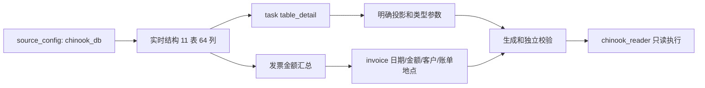

# Chinook 数据和查询范围

当前配置唯一绑定 `chinook_db` → `chinook` → `public` 下 11 张允许表。源 SQL 为 [Chinook_PostgreSql.sql](E:/电子杯/database/Chinook_PostgreSql.sql)，应用配置为 [source_config.json](E:/电子杯/database/source_config.json)。原始种子脚本含数据库创建和切换指令；日常查询不需要重新执行它。

## 11 表、64 列

| 表 | 列数 | 主键 | 主要信息 |
|---|---:|---|---|
| `public.album` | 3 | `album_id` | 专辑、标题、艺术家 ID |
| `public.artist` | 2 | `artist_id` | 艺术家 |
| `public.customer` | 13 | `customer_id` | 客户、公司、地址、联系方式、支持人员 ID |
| `public.employee` | 15 | `employee_id` | 员工、职位、直属上级、日期、地址、联系方式 |
| `public.genre` | 2 | `genre_id` | 曲风 |
| `public.invoice` | 9 | `invoice_id` | 客户、发票日期、账单地址、发票金额 |
| `public.invoice_line` | 5 | `invoice_line_id` | 发票、曲目、单价、数量 |
| `public.media_type` | 2 | `media_type_id` | 媒体类型 |
| `public.playlist` | 2 | `playlist_id` | 播放列表 |
| `public.playlist_track` | 2 | `playlist_id, track_id` | 播放列表和曲目的对应关系 |
| `public.track` | 9 | `track_id` | 曲目、专辑／媒体／曲风 ID、作曲者、时长、字节数、单价 |
| **合计** | **64** | | |

明细查询使用实时列清单，不在接口中接受任意表名。类型为 integer、text、decimal、timestamp；NULL 是否允许来自实时结构。金额列要求明确的 `NUMERIC(p,2)`，源数据是 `NUMERIC(10,2)`；时间列为 `timestamp without time zone`。

## 两种查询

发票汇总固定使用 `invoice.total` 和 `invoice.invoice_date`。`sales_amount` 的口径 ID 是 `chinook_sales_amount_v1`，语义为发票金额汇总。金额币种没有在源数据中标明，返回单位“金额”，不能默认写成“元”。可按客户、账单国家、账单城市做 eq/in 筛选。国家和城市为账单列，不等于客户资料地址。

单表明细明确 `task="table_detail"`，可以查上述任意一张表的全部列或选定列；支持 typed AND 筛选、固定 `NULLS LAST` 的排序和 OFFSET 分页。默认 100 行，单页最多 1000 行；查到表的全部记录需要按 `next_offset` 逐页读取。

## 快照和评估资料

| 项目位置 | 输入 → 输出 | 用途 |
|---|---|---|
| [metadata_reader.py](E:/电子杯/database/metadata_reader.py) | 当前库结构和权限 → snapshot/data | 真实执行前和同事务复核 |
| [chinook_snapshot.py](E:/电子杯/database/chinook_snapshot.py) | raw snapshot、实体、配置 → 增强语义快照 | 发票口径、国家／城市／客户候选 |
| [generated/chinook_schema_snapshot.json](E:/电子杯/database/generated/chinook_schema_snapshot.json) | 已保存结构 | 离线生成／校验样例，不能证明实时权限 |
| [generated/chinook_metadata.json](E:/电子杯/database/generated/chinook_metadata.json) | 已保存实体名单 | 离线映射样例 |
| [evaluation/datasets/chinook_sql_v1.jsonl](E:/电子杯/evaluation/datasets/chinook_sql_v1.jsonl) | 38 条冻结用例 | 35 条当前可测，3 条 roadmap |

独立发票 oracle 的固定期望包括全期 2328.60、2024 年 477.53、2024 年 USA 127.98。这些是该冻结种子数据的核对值，不是实时库当前状态或模型正确率的证明。全表明细审计另外比较全部源行、NULL、类型、排序和分页；结论以实际报告的前后哈希及各项检查为准。

运行和结构化请求见 [SQLService 使用说明](E:/电子杯/database/SQLService使用说明.md)；环境见 [本地数据库使用说明](E:/电子杯/database/本地数据库使用说明.md)；评估见 [Chinook 评估接口](E:/电子杯/docs/Chinook评估接口.md)。
