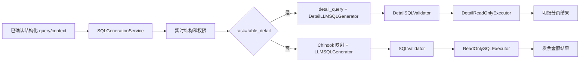

# Chinook 查询模块

交给队友接入时，先阅读 [队友交接说明](../docs/队友交接说明.md)，包含交付范围、换机配置、接口样例和验收记录。

项目唯一查询数据源为 `chinook_db`，连接数据库 `chinook`。统一入口是 [SQLGenerationService](E:/电子杯/src/agent_core/sql/generation_service.py) 的异步 `generate`、`generate_and_validate`、`query`；分别返回候选、已校验结果、只读执行结果。

支持两类请求：发票金额汇总，以及 `task="table_detail"` 的单表明细。明细覆盖允许的 11 张表、64 列；每次查询一张表，可以选择所有列、指定列、按类型筛选、排序和分页。发票指标保留 `sales_amount` / `chinook_sales_amount_v1`，金额来自 `public.invoice.total`，不假定币种。

## 运行

在 PowerShell 中：

```powershell
Set-Location -LiteralPath 'E:\电子杯'
$env:PYTHONPATH = 'E:\电子杯\src'

# 发票汇总：demo Provider + 真实只读数据库
& 'E:\Miniconda\python.exe' -B -m agent_core.sql.readonly_example

# 单表明细：默认实时读取、校验并只读执行
& 'E:\Miniconda\python.exe' -B -m agent_core.sql.detail_example --table public.track --page-size 100 --offset 0

# 离线文件结构：生成和校验，不执行业务查询
& 'E:\Miniconda\python.exe' -B -m agent_core.sql.detail_example --table public.track --offline --validate-only
```

示例 Provider 根据受控输入生成候选，未调用真实模型。2026-10-04 最终回归 330 项通过；[发票只读联调](E:/电子杯/evaluation/reports/chinook_live_demo.json) 35/35、[全表明细审计](E:/电子杯/evaluation/reports/chinook_detail_live_demo.json) 33/33 通过，明细覆盖 11 表、64 列和 15,607 行，前后完整源哈希一致。这些是 demo Provider + live 数据库的工程结果，尚未测真实模型质量。

## 请求与结果

| 请求 | 主要输入 | 主要输出 |
|---|---|---|
| 发票汇总 | 来源、明确时间区间、可选客户／账单国家／账单城市 | 一列 `sales_amount`、一行金额、指标定义、可信参数、验证和执行状态 |
| 单表明细 | `task`、表、投影列、AND 筛选、排序、`page` | 列描述、行数据、`row_count`、`page`、`has_more`、`next_offset` |
| 不完整或有歧义 | 缺失表／时间、含糊客户等 | `needs_clarification` 和结构化 `issues`，不执行业务 SQL |
| 不支持或不安全 | 未允许来源／表／操作、候选与需求不符 | `error`、稳定错误码、`execution_attempted` |

明细 `page.size` 默认 100，范围 1～1000；`page.offset` 默认 0，最大 1,000,000。全部排序键固定 `NULLS LAST`，自动追加缺失的完整主键。服务实际取 `size+1` 行，只返回前 `size` 行，额外一行用于判断下一页。配置或请求级行数限额可以降低实际页大小。



## 模块位置与交接

| 项目位置 | 输入 → 输出 | 职责 |
|---|---|---|
| [database/metadata_reader.py](E:/电子杯/database/metadata_reader.py) | 配置、预算 → 实时 raw snapshot、实体和权限 | 所有查询共享的结构读取 |
| [database/chinook_query.py](E:/电子杯/database/chinook_query.py) | 汇总需求、元数据 → 明确汇总请求／澄清 | 发票日期和客户／国家／城市映射 |
| [database/detail_query.py](E:/电子杯/database/detail_query.py) | 明细需求、raw snapshot → `PreparedDetail` | 列白名单、类型、排序、分页、可信参数 |
| [src/agent_core/sql/](E:/电子杯/src/agent_core/sql/generation_service.py) | 明确需求、无值参数说明 → SQL 候选／统一响应 | Provider 适配和流程编排 |
| [database/sql_validator.py](E:/电子杯/database/sql_validator.py)、[detail_validator.py](E:/电子杯/database/detail_validator.py) | 候选、可信需求和参数 → 已验证执行包／拒绝 | 独立 AST 校验、重建可信 SQL |
| [database/readonly_sql_executor.py](E:/电子杯/database/readonly_sql_executor.py)、[detail_executor.py](E:/电子杯/database/detail_executor.py) | 已验证执行包 → 只读结果 | 同事务重新核对结构、权限和参数 |
| [database/readonly_connection.py](E:/电子杯/database/readonly_connection.py) | 预算 → 只读事务和预算 cursor | 账号、数据库、事务、超时和取消 |
| [src/agent_core/evaluation/](E:/电子杯/src/agent_core/evaluation/example.py) | 冻结标准、实际观察 → 评分报告 | 与业务执行流程分离 |

详细接口、输入输出和各模块运行图见 [SQLService 使用说明](E:/电子杯/database/SQLService使用说明.md)、[LLM 生成](E:/电子杯/docs/SQL生成LLM接口.md)、[SQL 检验](E:/电子杯/docs/SQL检验接口.md)、[只读执行](E:/电子杯/docs/SQL只读执行接口.md)、[评估](E:/电子杯/docs/Chinook评估接口.md)。本地连接说明见 [本地数据库使用说明](E:/电子杯/database/本地数据库使用说明.md)。
