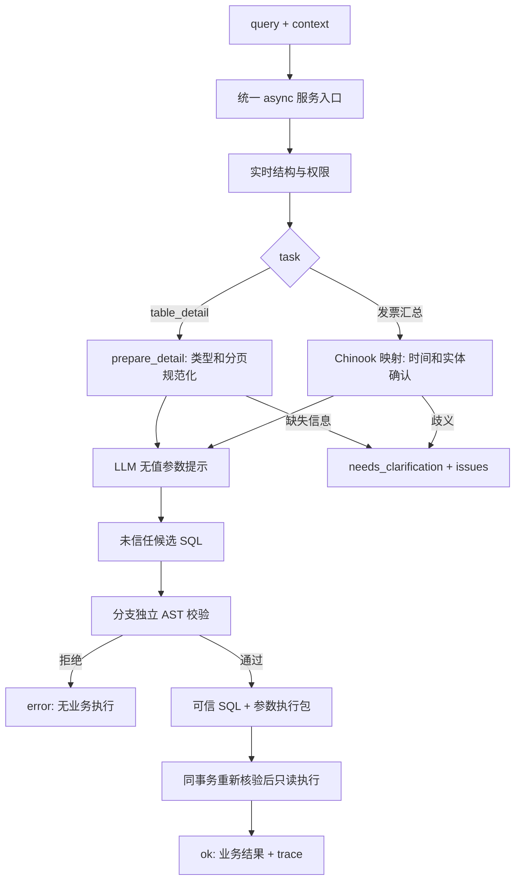

# Chinook SQL 服务使用说明

应用接入统一异步 [SQLGenerationService](E:/电子杯/src/agent_core/sql/generation_service.py)。数据库只支持 `source_id="chinook_db"`。它同时接入发票金额汇总和单表明细，保持生成、校验、执行三个公开阶段。

## 公开接口

```python
from agent_core.sql.generation_service import SQLGenerationService

service = SQLGenerationService(provider)
candidate = await service.generate(query, context=None)
validated = await service.generate_and_validate(query, context=None)
result = await service.query(query, context=None)
```

`provider` 实现 `async generate(LLMRequest) -> LLMResponse`。默认读取 [source_config.json](E:/电子杯/database/source_config.json)，配置必须绑定 `chinook_db` / `chinook`。可以注入 metadata reader 和执行器开展离线工程测试；真实执行要求实时权限核验。

| 方法 | 返回状态 | 是否执行业务 SQL |
|---|---|---|
| `generate` | `generated`／`needs_clarification`／`error` | 否 |
| `generate_and_validate` | `validated`／`needs_clarification`／`error` | 否 |
| `query` | `ok`／`needs_clarification`／`error` | 通过校验后只读执行 |

[database/sql_service.py](E:/电子杯/database/sql_service.py) 的同步 `SQLService.query` 是发票汇总的受控模板工具，不提供明细功能或 LLM 候选流程；新 Agent 集成应使用上述异步入口。

## 发票汇总输入

```json
{
  "source_id": "chinook_db",
  "metric_id": "sales_amount",
  "metric_definition_id": "chinook_sales_amount_v1",
  "time_range": {"start": "2024-01-01", "end_exclusive": "2025-01-01"},
  "filters": [
    {"field_id": "country", "op": "eq", "value": "美国"},
    {"field_id": "city", "op": "eq", "value": "Boston"}
  ]
}
```

指标固定为发票粒度的 `COALESCE(SUM(total), 0) AS sales_amount`。时间使用 `invoice_date`，左闭右开，必须明确；源列是无时区时间，因此按日历值比较，不把带时区时间自动转成数据库时间。账单国家、账单城市和客户支持 `eq`／`in`；客户 ID 必须是整数，客户名称或城市匹配有歧义则返回澄清。国家和城市同时指定时按 AND 交集筛选。

币种未知，单位为“金额”；不能把它解释为人民币收入、已支付净收入或扣退款后的金额。分组、跨表关联、排名及任意表达式不属于这条汇总接口。

## 单表明细输入

```json
{
  "source_id": "chinook_db",
  "task": "table_detail",
  "table": "public.track",
  "columns": ["track_id", "name", "milliseconds", "unit_price"],
  "filters": [
    {"column": "milliseconds", "op": "gte", "value": 180000},
    {"column": "name", "op": "starts_with", "value": "Love"}
  ],
  "order_by": [{"column": "unit_price", "direction": "desc"}],
  "page": {"size": 100, "offset": 0}
}
```

`table` 接受允许的裸表名或 `public.表名`。`columns` 默认 `"all"`，按实时结构的列顺序展开；也可给非空、无重复的列名列表。字段不能是 SQL 表达式。

| 输入 | 规则 |
|---|---|
| 表 | `album`、`artist`、`customer`、`employee`、`genre`、`invoice`、`invoice_line`、`media_type`、`playlist`、`playlist_track`、`track` |
| 筛选 | 最多 64 项，全部 AND；`eq`、`ne`、`in`、`gt`、`gte`、`lt`、`lte`、`is_null`、`is_not_null`、`contains`、`starts_with` |
| 类型 | 整数为真正整数；金额用两位精度的字符串；时间为无时区 ISO 字符串；文本按原值比较 |
| IN | 1～50 个同类型、非 NULL 值；重复值去重 |
| NULL | 用 `is_null`／`is_not_null`；不把 `eq: null` 解释成 `IS NULL` |
| 文本匹配 | `contains`／`starts_with` 仅文本；大小写敏感，`%`、`_`、反斜杠作为字面字符转义 |
| 排序 | 任意已知列的 `asc`／`desc`，固定 `NULLS LAST`，补齐缺失主键作为稳定并列排序键 |
| 分页 | `size` 默认 100，1～1000；`offset` 默认 0，0～1,000,000 |

范围比较仅支持整数、金额和时间列。文本值最大 4096 字符，禁止 NUL；小数拒绝 float、NaN、Infinity 和超出分精度的值；时间拒绝自动时区转换。页大小还受配置和 `context.max_rows` 限制。文本排序遵从实际数据库 collation；独立 oracle 的 Python Unicode 排序不能替代所有数据库文本排序语义，当前真实附加审计主要核对主键、整数、金额和日历时间排序。

## 输出与上下文

成功明细结果的业务字段如下；验证、元数据、参数和耗时另作为 trace 返回：

```json
{
  "status": "ok",
  "task": "table_detail",
  "source_id": "chinook_db",
  "table": "public.track",
  "columns": [
    {"name": "track_id", "data_type": "integer", "nullable": false},
    {"name": "name", "data_type": "text", "nullable": false}
  ],
  "rows": [],
  "row_count": 0,
  "page": {"size": 100, "offset": 0},
  "has_more": false,
  "next_offset": null
}
```

上面只展示结果形状，不是某个已运行请求的实际数据。金额输出两位小数字符串，整数输出 JSON 数字，时间输出无时区 ISO 字符串，数据库 NULL 输出 JSON null。空明细是合法结果；发票汇总无匹配记录返回零金额。

`context` 可带字符串 `session_id`、`task_id`、`request_id`、`step_id` 和受限预算。`query` 默认请求总预算 30 秒，上限 60 秒；模型预算默认／上限 15 秒；数据库语句预算默认／上限 5 秒；连接预算默认 3 秒，上限 5 秒；锁等待默认／上限 1 秒；连接加事务执行预算默认 10 秒，上限 15 秒。取消直接向调用方传播。

每页在独立只读事务中执行。主键排序保证当前数据集的顺序确定；并发数据变化可能影响跨页结果，不能把多次分页称为同一个永久冻结快照。



模块 I/O 和具体项目位置见 [生成](E:/电子杯/docs/SQL生成LLM接口.md)、[检验](E:/电子杯/docs/SQL检验接口.md)、[执行](E:/电子杯/docs/SQL只读执行接口.md)。
