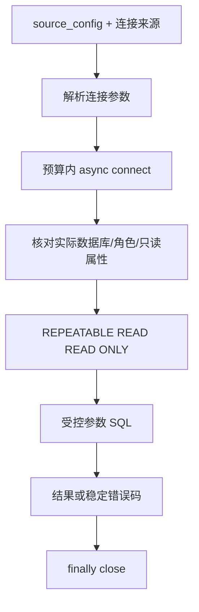

# 本地 Chinook 数据库使用说明

项目配置连接现有本机 PostgreSQL `127.0.0.1:5432/chinook`，应用只读账号为 `chinook_reader`。2026-10-04 已基于最终代码重新核验；[发票只读报告](E:/电子杯/evaluation/reports/chinook_live_demo.json) 35/35、[全表明细报告](E:/电子杯/evaluation/reports/chinook_detail_live_demo.json) 33/33 通过，后者覆盖 11 表、64 列和 15,607 行，前后完整源哈希一致。两次运行均使用 demo Provider，没有验证真实模型质量。

## 环境和连接

| 项目 | 配置 |
|---|---|
| PostgreSQL 程序目录 | `H:\PostgreSQL\bin` |
| Windows 服务 | `postgresql-x64-18` |
| 地址 | `127.0.0.1:5432` |
| 数据库 | `chinook` |
| 应用角色 | `chinook_reader` |
| 配置 | [source_config.json](E:/电子杯/database/source_config.json) |
| 本地连接文件 | `E:\电子杯\database\.local\connection_chinook.json` |

连接文件使用 Windows DPAPI 保存密码，由同一 Windows 用户解密。应用读取配置并验证实际连接的数据库和只读身份；业务查询不能改用管理员。不要将连接文件内容或密码写入报告、提示词、代码和日志。

任一配置的 `PGHOST`、`PGPORT`、`PGDATABASE`、`PGUSER`、`PGPASSWORD`、`PGSSLMODE` 环境变量存在时，服务使用环境连接配置，至少需要完整的 `PGHOST`、`PGDATABASE`、`PGUSER`。环境配置不会与本地文件中的密码混合，也不在配置不完整时偷偷回退。

若希望使用现有连接文件，可仅清除当前 PowerShell 会话的这些变量：

```powershell
foreach ($chinookPgName in @('PGHOST', 'PGPORT', 'PGDATABASE', 'PGUSER', 'PGPASSWORD', 'PGSSLMODE')) {
    Remove-Item -LiteralPath "Env:$chinookPgName" -ErrorAction SilentlyContinue
}
```

查看服务状态：

```powershell
Get-Service -Name 'postgresql-x64-18'
```

服务停止时可从 Windows 服务管理器启动它。日常查询使用现有 Chinook 库，不需要重新导入种子 SQL。

## 查询命令

```powershell
Set-Location -LiteralPath 'E:\电子杯'
$env:PYTHONPATH = 'E:\电子杯\src'

# 发票汇总：demo Provider + 实时只读执行
& 'E:\Miniconda\python.exe' -B -m agent_core.sql.readonly_example

# 任意允许表的单页明细
& 'E:\Miniconda\python.exe' -B -m agent_core.sql.detail_example --table public.customer --page-size 100 --offset 0

# 下一页；实际继续位置应以响应 next_offset 为准
& 'E:\Miniconda\python.exe' -B -m agent_core.sql.detail_example --table public.track --page-size 100 --offset 100

# 离线文件结构，仅生成和校验
& 'E:\Miniconda\python.exe' -B -m agent_core.sql.detail_example --table public.track --offline --validate-only

# 输出增强的实时结构，不覆盖文件
& 'E:\Miniconda\python.exe' -B -m database.enrich_schema_snapshot --live
```

`--offline` 明确使用文件元数据；不能证明当前库的权限，也不能执行业务 SQL。应用示例使用 demo Provider，不提供真实模型效果成绩。

## 在 VS Code 查看

使用 PostgreSQL 扩展创建连接，填写 `127.0.0.1`、端口 `5432`、数据库 `chinook` 和已有授权的账号。查询可使用 `chinook_reader`；密码在扩展的受保护凭据输入中填写。不要把密码写入 SQL 文档或终端示例。

程序公开接口见 [SQLService 使用说明](E:/电子杯/database/SQLService使用说明.md)。明细默认页大小 100、最多 1000，响应 `has_more=true` 时按 `next_offset` 继续；一个请求不会一次返回全库所有记录。

## 连接模块运行图

项目位置：[connection_settings.py](E:/电子杯/database/connection_settings.py)、[sql_common.py](E:/电子杯/database/sql_common.py)、[readonly_connection.py](E:/电子杯/database/readonly_connection.py)。输入是配置、可选环境和时间预算；输出是绑定 Chinook 的只读事务 cursor，失败为稳定错误码。



全表和模型质量核对见 [Chinook 评估接口](E:/电子杯/docs/Chinook评估接口.md)，以实际运行报告为准。
